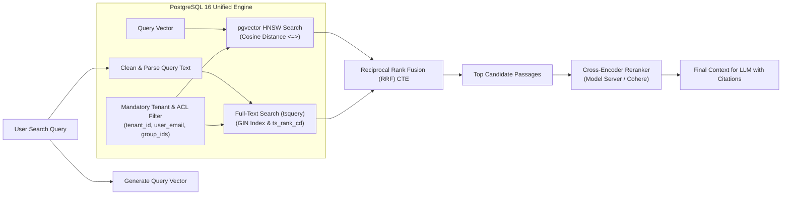

# Production Application Architecture Design

This document specifies the revised production architecture for building an enterprise knowledge intelligence and autonomous AI agent platform. It replaces OpenSearch with a **unified PostgreSQL 16+ engine utilizing `pgvector` and Full-Text Search (FTS)**, behind a decoupled `SearchProvider` interface that ensures a seamless future migration path.

---

## 1. High-Level System Architecture Diagram

```mermaid
flowchart TD
    subgraph Clients["Client Tier"]
        Browser["Next.js Web Client\n(App Router / React 19)"]
        MobileApp["React Native / Expo Mobile App"]
        ChatBots["Slackbot & Teams Webhook Listeners"]
        AgentClients["External AI Agents (MCP / REST)"]
    end

    subgraph EdgeGateway["Edge & Reverse Proxy Tier"]
        Traefik["Edge Reverse Proxy & TLS Termination\n(Traefik / Nginx)"]
    end

    subgraph ApplicationTier["Application & API Tier"]
        APIServer["FastAPI Stateless Application Server\n(Python 3.13 / Uvicorn)"]
        MCPServer["FastMCP Tool Server\n(Exposes internal tools to agents)"]
        SearchInterface["SearchProvider Interface\n(Abstract Retrieval Contract)"]
    end

    subgraph WorkersTier["Asynchronous Execution & Background Tier"]
        TaskBroker[("Redis 7+ Task Broker & Locks")]
        CeleryWorker["Celery Worker Fleet\n(Dedicated Queues: Ingestion, Fetching, Pruning)"]
        CeleryBeat["Celery Beat Periodic Scheduler"]
    end

    subgraph ModelTier["Model & Inference Tier"]
        ModelServer["Dedicated Model Server\n(HuggingFace Embeddings & Cross-Encoder)"]
        ExternalLLMs["External LLM Gateway\n(OpenAI, Anthropic, Gemini, Bedrock)"]
    end

    subgraph StorageTier["Data & Storage Tier (Single Source of Truth)"]
        Postgres[("PostgreSQL 16+ Database\n- Relational Metadata & Auth\n- Full-Text Search (tsvector GIN)\n- pgvector (HNSW Cosine Distance)")]
        ObjectStore[("S3-Compatible Object Store\n(MinIO / AWS S3 / Cloudflare R2)")]
        CacheStore[("Redis Cache & Rate Limiting")]
    end

    subgraph SandboxTier["Secure Execution Tier"]
        CodeSandbox["Isolated Code Interpreter\n(gVisor / Docker Sandboxed Python)"]
    end

    %% Routing
    Clients --> Traefik
    Traefik -->|/api/* (Direct Streaming)| APIServer
    Traefik -->|/mcp/*| MCPServer
    Traefik -->|/*| Browser

    %% API Server to Search Interface
    APIServer --> SearchInterface
    SearchInterface -->|PgVectorSearchProvider| Postgres

    %% API Server Connections
    APIServer --> Postgres
    APIServer --> CacheStore
    APIServer --> TaskBroker
    APIServer --> ModelServer
    APIServer --> ExternalLLMs
    APIServer --> ObjectStore
    APIServer --> CodeSandbox

    %% Background Workers
    CeleryBeat --> TaskBroker
    TaskBroker --> CeleryWorker
    CeleryWorker --> Postgres
    CeleryWorker --> ModelServer
    CeleryWorker --> ObjectStore
```

---

## 2. Key Architectural Decisions & The Unified PostgreSQL Design

### A. The Pluggable `SearchProvider` Interface
To guarantee that the application can switch from PostgreSQL + `pgvector` to dedicated engines (e.g., OpenSearch or Qdrant) without rewriting chat, RAG, ingestion, or agent workflows, all search operations are mediated by an abstract interface:

```python
class SearchProvider(ABC):
    @abstractmethod
    async def index_chunks(
        self, tenant_id: UUID, chunks: list[ChunkRecord]
    ) -> None:
        """Indexes text, vectors, and ACL attributes."""

    @abstractmethod
    async def hybrid_search(
        self,
        tenant_id: UUID,
        query: str,
        query_vector: list[float],
        user_identity: UserIdentity,
        filters: SearchFilters,
        limit: int = 50,
    ) -> list[ScoredChunk]:
        """Executes hybrid retrieval with RRF and ACL enforcement."""

    @abstractmethod
    async def delete_document_chunks(
        self, tenant_id: UUID, document_id: str
    ) -> None:
        """Purges chunks for a deleted document."""
```

The application ships with **`PgVectorSearchProvider`** as its active default. RAG workflows, agent tools, and ingestion workers interact exclusively with this contract.

---

### B. PostgreSQL Hybrid Retrieval Architecture

Rather than maintaining two distinct databases (Postgres for relational data and OpenSearch for vectors), PostgreSQL 16 handles both paradigms through two complementary extensions:



1. **Semantic Vector Search (`pgvector`)**:
   - Stores dense embeddings (e.g., 1024-dimensional float arrays from BGE-large or 1536-dimensional vectors from OpenAI).
   - Indexed via **HNSW (Hierarchical Navigable Small World)** with cosine distance operators (`<=>`).
   - Supports sub-millisecond approximate nearest neighbor lookups within each tenant boundary.
2. **Keyword Full-Text Search (FTS)**:
   - Chunks maintain a generated `tsvector` column combining chunk content, document titles, and path metadata.
   - Indexed via **GIN (Generalized Inverted Index)**.
   - Queries use `websearch_to_tsquery('english', query)` to support natural queries with quotes and boolean operators, scored via `ts_rank_cd`.
3. **Reciprocal Rank Fusion (RRF)**:
   - Combines vector rankings ($R_{\text{vector}}$) and keyword rankings ($R_{\text{keyword}}$) in SQL using Reciprocal Rank Fusion ($k=60$):
     $$\text{RRF Score} = \frac{1}{60 + R_{\text{vector}}} + \frac{1}{60 + R_{\text{keyword}}}$$
   - Eliminates the need to normalize incompatible vector cosine distances and BM25/`ts_rank` scores.
4. **Mandatory Query-Time Security & ACL Filtering**:
   - Every search query includes mandatory SQL `WHERE` clauses matching `tenant_id` and testing the chunk's `access_control_list` array against the user's email and groups:
     ```sql
     WHERE tenant_id = :tenant_id
       AND (is_public = true 
            OR user_email = :current_user_email 
            OR group_id = ANY(:current_user_group_ids))
     ```
5. **Cross-Encoder Reranking**:
   - The top 50 candidates returned by RRF are sent to the dedicated cross-encoder model server, producing high-precision relevance scores before context window packing.

---

### C. Eliminating the Double-Proxy Streaming Bottleneck
The edge reverse proxy (Traefik / Nginx) routes `/api/*` **directly to FastAPI**, while routing static assets and SSR pages to Next.js. Server-Sent Events (SSE) stream straight from FastAPI to the browser without intermediate Node.js buffering, cutting memory overhead by > 60%.

---

## 3. Scalability Boundaries & Future Migration Triggers

PostgreSQL with `pgvector` provides a resilient, highly capable, and operationally simple foundation. However, dedicated search engines (OpenSearch or Qdrant) may be warranted under specific enterprise scaling conditions.

### Expected Performance of PostgreSQL + pgvector:
- **Up to 1,000,000 chunks**: Sub-100 ms hybrid search latency with HNSW indexing.
- **1,000,000 to 3,000,000 chunks**: 100–300 ms latency with properly sized PostgreSQL `shared_buffers` and `work_mem`.
- **Single Database Simplicity**: Backups (`pg_dump` / WAL-G), ACID transactions, point-in-time recovery, and zero cross-database synchronization lag.

### Measurable Triggers for Migrating to OpenSearch or Qdrant:
1. **Corpus Volume Threshold**: The total chunk volume exceeds **3,000,000 chunks** per PostgreSQL cluster node.
2. **Memory Saturation**: HNSW vector indices exceed 70% of available server RAM, causing cache evictions for standard relational queries.
3. **Query Concurrency SLA**: Sustained search query load exceeds **50 QPS** with p95 search latency exceeding **300 ms**.
4. **Advanced Linguistics Requirements**: Need for advanced language-specific analyzers, custom tokenizers, synonym dictionaries, and phonetic algorithms (e.g., Kuromoji for Japanese or ICU tokenizers) beyond standard PostgreSQL text dictionaries.

When any of these conditions are met, a dedicated search provider (e.g., `OpenSearchSearchProvider` or `QdrantSearchProvider`) can be activated by changing a single configuration key (`SEARCH_PROVIDER=opensearch`), leaving all core application logic completely untouched.
