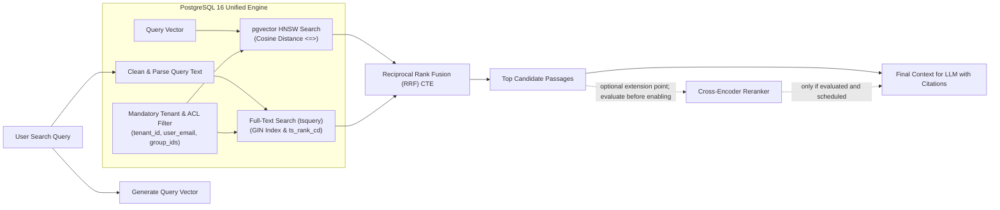

# Production Application Architecture Design

This document specifies Nexora's approved architecture direction. The initial search design uses a **unified PostgreSQL 16+ engine utilizing `pgvector` and Full-Text Search (FTS)** behind a `SearchProvider` contract. The MVP deployment is single-tenant; the architecture does not claim tenant isolation from tenant identifiers alone.

---

## 1. High-Level System Architecture Diagram

```mermaid
flowchart TD
    subgraph Clients["Client Tier"]
        Browser["Next.js Web Client\n(App Router / React 19)"]
        MobileApp["React Native / Expo Mobile App"]
        ChatBots["Slackbot & Teams Webhook Listeners"]
        AgentClients["External AI Agents (MCP / REST)"]
    end

    subgraph EdgeGateway["Edge & Reverse Proxy Tier"]
        Nginx["Nginx Reverse Proxy & TLS Termination"]
    end

    subgraph ApplicationTier["Application & API Tier"]
        APIServer["FastAPI Stateless Application Server\n(Python 3.13 / Uvicorn)"]
        MCPServer["FastMCP Tool Server\n(Exposes internal tools to agents)"]
        SearchInterface["SearchProvider Interface\n(Abstract Retrieval Contract)"]
    end

    subgraph WorkersTier["Asynchronous Execution & Background Tier"]
        TaskBroker[("Redis 7+ Task Broker\n(added with document ingestion)")]
        CeleryWorker["Celery Worker\n(added with document ingestion)"]
        CeleryBeat["Celery Beat\n(only if later scheduled work needs it)"]
    end

    subgraph ModelTier["Model & Inference Tier"]
        ModelServer["Embedding Provider\n(model/provider unresolved;\nreranking optional)"]
        ExternalLLMs["External LLM Gateway\n(OpenAI, Anthropic, Gemini, Bedrock)"]
    end

    subgraph StorageTier["Data & Storage Tier"]
        Postgres[("PostgreSQL 16+ Database\n- Relational Metadata & Auth\n- Full-Text Search (tsvector GIN)\n- pgvector (HNSW Cosine Distance)")]
        ObjectStore[("S3-Compatible Object Store\n(MinIO / AWS S3 / Cloudflare R2)")]
    end

    subgraph SandboxTier["Secure Execution Tier"]
        CodeSandbox["Isolated Code Interpreter\n(gVisor / Docker Sandboxed Python)"]
    end

    %% Routing
    Clients --> Nginx
    Nginx -->|/api/* (Direct Streaming)| APIServer
    Nginx -->|/mcp/*| MCPServer
    Nginx -->|/*| Browser

    %% API Server to Search Interface
    APIServer --> SearchInterface
    SearchInterface -->|PgVectorSearchProvider| Postgres

    %% API Server Connections
    APIServer --> Postgres
    APIServer --> ModelServer
    APIServer --> ExternalLLMs
    APIServer --> ObjectStore
    APIServer --> CodeSandbox

    %% Background Workers
    CeleryBeat --> TaskBroker
    APIServer -. "create ingestion job (Sprint 2)" .-> TaskBroker
    TaskBroker --> CeleryWorker
    CeleryWorker --> Postgres
    CeleryWorker --> ModelServer
    CeleryWorker --> ObjectStore
```

Redis and the Celery worker are introduced with asynchronous document ingestion, not Sprint 1. Redis is not the browser-session store; no general-purpose cache, lock, or rate-limit responsibility is approved by this architecture.

The diagram includes later-phase components for context. They are not all part of the MVP or Sprint 1.

### Browser authentication and API boundary

The first-party browser application uses opaque server-side sessions. The browser sends the session cookie to the same-origin Nginx reverse proxy, which routes `/api/*` directly to FastAPI and other application routes to Next.js. Cookie-authenticated state-changing requests require CSRF protections and Origin validation. Session cookies are HTTP-only, production Secure, SameSite=Lax, Path=/, and host-only. Passwords use Argon2id. The initial administrator is created through a one-time setup command. Sessions have a 30-minute sliding idle timeout and a 12-hour absolute lifetime; activity never extends the absolute expiry. Expired sessions are invalidated server-side, and logout immediately invalidates the session.

Public registration versus administrator-managed account provisioning remains open. Do not implement public self-registration until that policy is decided.

### Single-tenant MVP

Each initial deployment has one tenant selected by trusted server configuration or setup state; clients cannot choose or override the tenant context. Tenant identifiers may be retained in the data model for future growth, but do not by themselves enforce isolation. RLS is not part of the MVP. Its policy, transaction-bound context, connection-pool reset, and security tests require a separately approved design before implementation.

---

## 2. Key Architectural Decisions & The Unified PostgreSQL Design

### A. The Pluggable `SearchProvider` Interface
To keep retrieval consumers independent of the current backend and enable future evaluation of other engines, search operations are mediated by an abstract interface. This contract does not make provider migration automatic:

For the single-tenant MVP, `tenant_id` is derived from trusted server-side context and must never be accepted as a client-selected authorization boundary.

```python
class SearchProvider(ABC):
    @abstractmethod
    async def index_chunks(
        self, tenant_id: UUID, chunks: list[ChunkRecord]
    ) -> None:
        """Indexes text, vectors, and ACL attributes."""

    @abstractmethod
    async def hybrid_search(
        self,
        tenant_id: UUID,
        query: str,
        query_vector: list[float],
        user_identity: UserIdentity,
        filters: SearchFilters,
        limit: int = 50,
    ) -> list[ScoredChunk]:
        """Executes hybrid retrieval with RRF and ACL enforcement."""

    @abstractmethod
    async def delete_document_chunks(
        self, tenant_id: UUID, document_id: str
    ) -> None:
        """Purges chunks for a deleted document."""
```

The application ships with **`PgVectorSearchProvider`** as its active default. RAG workflows, agent tools, and ingestion workers interact exclusively with this contract.

---

### B. PostgreSQL Hybrid Retrieval Architecture

Rather than maintaining separate relational and search databases, PostgreSQL 16 combines relational storage, native Full-Text Search, and the `pgvector` extension:



1. **Semantic Vector Search (`pgvector`)**:
   - Embedding provider, model, dimension, and versioning strategy are unresolved and must be selected before the embedding schema is implemented.
   - Indexed via **HNSW (Hierarchical Navigable Small World)** with cosine distance operators (`<=>`).
   - Index settings and latency must be measured; the single-tenant MVP does not establish a multi-tenant boundary.
2. **Keyword Full-Text Search (FTS)**:
   - Chunks maintain a generated `tsvector` column combining chunk content, document titles, and path metadata.
   - Indexed via **GIN (Generalized Inverted Index)**.
   - Queries use PostgreSQL text-search parsing and ranking (the proposed example uses `websearch_to_tsquery` and `ts_rank_cd`). This is PostgreSQL FTS, not BM25; analyzer choices require evaluation.
3. **Reciprocal Rank Fusion (RRF)**:
   - Combines vector rankings ($R_{\text{vector}}$) and keyword rankings ($R_{\text{keyword}}$) in SQL using Reciprocal Rank Fusion ($k=60$):
     $$\text{RRF Score} = \frac{1}{60 + R_{\text{vector}}} + \frac{1}{60 + R_{\text{keyword}}}$$
   - Eliminates the need to normalize incompatible vector distances and full-text ranking scores.
4. **Query-Time Authorization**:
   - Every search query must enforce the approved user/document access policy before results leave PostgreSQL. The schema's ACL representations are illustrative and inconsistent; resolve the canonical model before search implementation. Tenant identifiers alone are not authorization.
     ```sql
     WHERE tenant_id = :tenant_id
       AND (is_public = true 
            OR user_email = :current_user_email 
            OR group_id = ANY(:current_user_group_ids))
     ```
5. **Optional Reranking Extension Point**:
   - Keep the retrieval flow extensible between candidate retrieval and context packing. Do not run a cross-encoder in the MVP until evaluation demonstrates value or it is explicitly scheduled.

---

### C. Eliminating the Double-Proxy Streaming Bottleneck
The approved edge reverse proxy is Nginx. It routes same-origin `/api/*` **directly to FastAPI**, while routing frontend pages and assets to Next.js. Server-Sent Events (SSE) stream straight from FastAPI to the browser without an intermediate Next.js API proxy. Any latency or resource benefit must be measured rather than assumed.

---

## 3. Scalability Boundaries & Future Migration Triggers

PostgreSQL with `pgvector` provides the approved initial foundation. Any future dedicated search engine (OpenSearch or Qdrant) requires measured evidence, a migration plan, and a separately approved decision.

### Expected Performance of PostgreSQL + pgvector:
- Existing latency and corpus estimates are hypotheses, not guaranteed performance. Validate them using a defined benchmark corpus, hardware profile, concurrency, and percentile methodology before treating them as targets or migration triggers.
- **Single Database Simplicity**: Backups (`pg_dump` / WAL-G), ACID transactions, point-in-time recovery, and zero cross-database synchronization lag.

### Proposed Evaluation Prompts for a Future Provider Review
The numeric values below are unvalidated prompts for future measurement, not approved migration triggers or service guarantees.

1. **Corpus Volume Threshold**: The total chunk volume exceeds **3,000,000 chunks** per PostgreSQL cluster node.
2. **Memory Saturation**: HNSW vector indices exceed 70% of available server RAM, causing cache evictions for standard relational queries.
3. **Query Concurrency SLA**: Sustained search query load exceeds **50 QPS** with p95 search latency exceeding **300 ms**.
4. **Advanced Linguistics Requirements**: Need for advanced language-specific analyzers, custom tokenizers, synonym dictionaries, and phonetic algorithms (e.g., Kuromoji for Japanese or ICU tokenizers) beyond standard PostgreSQL text dictionaries.

These proposed scale triggers prompt evaluation only; they do not automatically select a new provider. A provider change requires reindexing and operational and security review.
