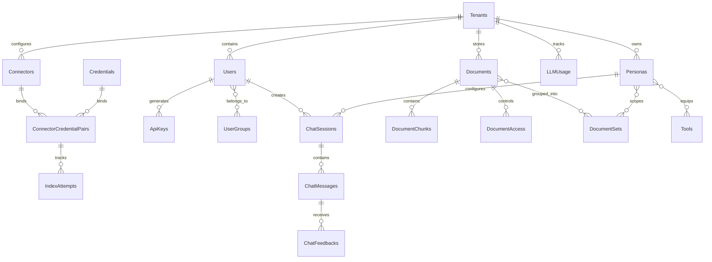

# Initial Database Architecture & Entity Design

This document records a proposed relational model for the single-tenant MVP and the approved **PostgreSQL 16+ hybrid search direction using `pgvector` and Full-Text Search (FTS)**. The examples are design material, not migrations or an approved complete schema.

**Approved initial search architecture:** PostgreSQL 16+ with `pgvector` and PostgreSQL Full-Text Search (FTS), accessed through the `SearchProvider` contract. OpenSearch and Qdrant are possible future providers only; they are not part of the approved implementation.

---

## 1. Entity Relationship Diagram (ERD)



---

## 2. Foundational Relational Entities

### A. Extensions & Tenant-Aware Data Shape

The MVP is a single-tenant deployment. Tenant context is selected and enforced server-side; clients cannot choose or override it. Tenant identifiers in this proposed schema are for data-model continuity and do not provide isolation by themselves. Do not implement or claim RLS until its complete policy, transaction-bound context-setting mechanism, connection-pool reset strategy, and security tests are approved.

```sql
-- Enable vector search extension
CREATE EXTENSION IF NOT EXISTS vector;
CREATE EXTENSION IF NOT EXISTS pg_trgm;

CREATE TABLE tenants (
    id UUID PRIMARY KEY DEFAULT gen_random_uuid(),
    name VARCHAR(255) NOT NULL,
    slug VARCHAR(64) UNIQUE NOT NULL,
    is_active BOOLEAN NOT NULL DEFAULT true,
    created_at TIMESTAMPTZ NOT NULL DEFAULT NOW(),
    updated_at TIMESTAMPTZ NOT NULL DEFAULT NOW()
);

CREATE TABLE tenant_settings (
    tenant_id UUID PRIMARY KEY REFERENCES tenants(id) ON DELETE CASCADE,
    allowed_auth_types JSONB NOT NULL DEFAULT '["local", "google", "github"]',
    default_model VARCHAR(128) NOT NULL DEFAULT 'gpt-4o',
    branding_logo_url TEXT,
    primary_color_hex VARCHAR(7) DEFAULT '#3b82f6',
    created_at TIMESTAMPTZ NOT NULL DEFAULT NOW(),
    updated_at TIMESTAMPTZ NOT NULL DEFAULT NOW()
);
```

---

### B. Identity, Users & Roles

The approved browser authentication model uses opaque server-side sessions. Local passwords are hashed with Argon2id. The initial administrator is created through a one-time setup command. Sprint 1 must add session persistence that supports lookup by the stored token digest, association to a user, expiration, and invalidation; store only the digest, never the browser token. Sessions use a 30-minute sliding idle timeout and a 12-hour absolute lifetime; activity never extends the absolute expiry. Expired sessions are invalidated server-side, and logout immediately invalidates the session. Provider API keys are not stored until their configuration and secure-storage approach are approved.

The public-registration versus administrator-managed account-provisioning policy and password reset flow remain open. Do not infer open registration from the example user table.

```sql
CREATE TYPE user_role AS ENUM ('admin', 'global_curator', 'curator', 'basic');

CREATE TABLE users (
    id UUID PRIMARY KEY DEFAULT gen_random_uuid(),
    tenant_id UUID NOT NULL REFERENCES tenants(id) ON DELETE CASCADE,
    email VARCHAR(320) NOT NULL,
    hashed_password VARCHAR(255),
    full_name VARCHAR(255),
    role user_role NOT NULL DEFAULT 'basic',
    is_active BOOLEAN NOT NULL DEFAULT true,
    is_verified BOOLEAN NOT NULL DEFAULT false,
    created_at TIMESTAMPTZ NOT NULL DEFAULT NOW(),
    updated_at TIMESTAMPTZ NOT NULL DEFAULT NOW(),
    CONSTRAINT uq_tenant_user_email UNIQUE (tenant_id, email)
);

CREATE TABLE user_groups (
    id UUID PRIMARY KEY DEFAULT gen_random_uuid(),
    tenant_id UUID NOT NULL REFERENCES tenants(id) ON DELETE CASCADE,
    name VARCHAR(128) NOT NULL,
    description TEXT,
    created_at TIMESTAMPTZ NOT NULL DEFAULT NOW(),
    CONSTRAINT uq_tenant_group_name UNIQUE (tenant_id, name)
);

CREATE TABLE user_group_members (
    user_id UUID NOT NULL REFERENCES users(id) ON DELETE CASCADE,
    group_id UUID NOT NULL REFERENCES user_groups(id) ON DELETE CASCADE,
    PRIMARY KEY (user_id, group_id)
);

CREATE TABLE api_keys (
    id UUID PRIMARY KEY DEFAULT gen_random_uuid(),
    tenant_id UUID NOT NULL REFERENCES tenants(id) ON DELETE CASCADE,
    user_id UUID NOT NULL REFERENCES users(id) ON DELETE CASCADE,
    name VARCHAR(128) NOT NULL,
    api_key_hash VARCHAR(64) NOT NULL UNIQUE,
    role_override user_role,
    expires_at TIMESTAMPTZ,
    created_at TIMESTAMPTZ NOT NULL DEFAULT NOW()
);
```

`api_keys` represents Nexora-issued API credentials in this proposal; it is not a design for storing OpenAI, Anthropic, or other provider API keys.

The Sprint 1 session record should include a user foreign key, a unique digest of the opaque session token, a digest of the session's CSRF token, creation and last-seen timestamps, idle and absolute expiry timestamps, and a nullable revocation timestamp. Session lookup must never require storing the browser token in plaintext. Password-change/reset and account-disable flows must invalidate affected sessions when those flows are implemented.

---

### C. Connectors & Ingestion Pipeline
```sql
CREATE TYPE connector_status AS ENUM ('active', 'paused', 'error', 'syncing');

CREATE TABLE connectors (
    id UUID PRIMARY KEY DEFAULT gen_random_uuid(),
    tenant_id UUID NOT NULL REFERENCES tenants(id) ON DELETE CASCADE,
    name VARCHAR(255) NOT NULL,
    source_type VARCHAR(64) NOT NULL, -- google_drive, slack, confluence, github
    config_json JSONB NOT NULL DEFAULT '{}',
    sync_frequency_minutes INT NOT NULL DEFAULT 60,
    created_at TIMESTAMPTZ NOT NULL DEFAULT NOW()
);

-- Connector credentials only. This is not a provider API-key storage design.
CREATE TABLE credentials (
    id UUID PRIMARY KEY DEFAULT gen_random_uuid(),
    tenant_id UUID NOT NULL REFERENCES tenants(id) ON DELETE CASCADE,
    source_type VARCHAR(64) NOT NULL,
    credential_encrypted BYTEA NOT NULL, -- AES-GCM 256 ciphertext
    created_at TIMESTAMPTZ NOT NULL DEFAULT NOW()
);

CREATE TABLE connector_credential_pairs (
    id UUID PRIMARY KEY DEFAULT gen_random_uuid(),
    tenant_id UUID NOT NULL REFERENCES tenants(id) ON DELETE CASCADE,
    connector_id UUID NOT NULL REFERENCES connectors(id) ON DELETE CASCADE,
    credential_id UUID NOT NULL REFERENCES credentials(id) ON DELETE CASCADE,
    status connector_status NOT NULL DEFAULT 'active',
    last_sync_at TIMESTAMPTZ,
    created_at TIMESTAMPTZ NOT NULL DEFAULT NOW(),
    CONSTRAINT uq_connector_credential UNIQUE (connector_id, credential_id)
);

CREATE TABLE index_attempts (
    id BIGSERIAL PRIMARY KEY,
    cc_pair_id UUID NOT NULL REFERENCES connector_credential_pairs(id) ON DELETE CASCADE,
    status VARCHAR(32) NOT NULL, -- IN_PROGRESS, SUCCESS, FAILED
    total_docs_indexed INT NOT NULL DEFAULT 0,
    new_docs_indexed INT NOT NULL DEFAULT 0,
    error_trace TEXT,
    started_at TIMESTAMPTZ NOT NULL DEFAULT NOW(),
    finished_at TIMESTAMPTZ
);
```

---

### D. Documents, Document Chunks & Unified Search Schema
```sql
CREATE TABLE documents (
    id VARCHAR(512) NOT NULL, -- external canonical URI: google_drive__1x2y3z
    tenant_id UUID NOT NULL REFERENCES tenants(id) ON DELETE CASCADE,
    title VARCHAR(512) NOT NULL,
    source_url TEXT,
    source_type VARCHAR(64) NOT NULL,
    metadata_json JSONB NOT NULL DEFAULT '{}',
    doc_updated_at TIMESTAMPTZ,
    created_at TIMESTAMPTZ NOT NULL DEFAULT NOW(),
    PRIMARY KEY (tenant_id, id)
);

-- Core Unified Hybrid Search Table
CREATE TABLE document_chunks (
    id UUID PRIMARY KEY DEFAULT gen_random_uuid(),
    tenant_id UUID NOT NULL REFERENCES tenants(id) ON DELETE CASCADE,
    document_id VARCHAR(512) NOT NULL,
    chunk_index INT NOT NULL,
    title VARCHAR(512) NOT NULL,
    content TEXT NOT NULL,
    -- Full-Text Search TSVECTOR column generated automatically
    tsv_content TSVECTOR GENERATED ALWAYS AS (
        to_tsvector('english', coalesce(title, '') || ' ' || coalesce(content, ''))
    ) STORED,
    -- Embedding column omitted until provider, model, dimension, and versioning are approved.
    source_type VARCHAR(64) NOT NULL,
    source_url TEXT,
    -- Proposed ACL representation only; canonical authorization model remains unresolved.
    access_control_list TEXT[] NOT NULL DEFAULT '{}',
    metadata_json JSONB NOT NULL DEFAULT '{}',
    created_at TIMESTAMPTZ NOT NULL DEFAULT NOW(),
    FOREIGN KEY (tenant_id, document_id) REFERENCES documents(tenant_id, id) ON DELETE CASCADE,
    CONSTRAINT uq_tenant_doc_chunk UNIQUE (tenant_id, document_id, chunk_index)
);

CREATE TABLE document_sets (
    id UUID PRIMARY KEY DEFAULT gen_random_uuid(),
    tenant_id UUID NOT NULL REFERENCES tenants(id) ON DELETE CASCADE,
    name VARCHAR(128) NOT NULL,
    description TEXT,
    is_up_to_date BOOLEAN NOT NULL DEFAULT true,
    created_at TIMESTAMPTZ NOT NULL DEFAULT NOW(),
    CONSTRAINT uq_tenant_docset_name UNIQUE (tenant_id, name)
);

CREATE TABLE document_set_documents (
    tenant_id UUID NOT NULL,
    document_set_id UUID NOT NULL REFERENCES document_sets(id) ON DELETE CASCADE,
    document_id VARCHAR(512) NOT NULL,
    PRIMARY KEY (document_set_id, document_id),
    FOREIGN KEY (tenant_id, document_id) REFERENCES documents(tenant_id, id) ON DELETE CASCADE
);

CREATE TABLE document_access (
    id BIGSERIAL PRIMARY KEY,
    tenant_id UUID NOT NULL,
    document_id VARCHAR(512) NOT NULL,
    user_email VARCHAR(320),
    group_id UUID REFERENCES user_groups(id) ON DELETE CASCADE,
    is_public BOOLEAN NOT NULL DEFAULT false,
    FOREIGN KEY (tenant_id, document_id) REFERENCES documents(tenant_id, id) ON DELETE CASCADE
);
```

---

### E. AI Personas, Tools & Assistants
```sql
CREATE TABLE personas (
    id UUID PRIMARY KEY DEFAULT gen_random_uuid(),
    tenant_id UUID NOT NULL REFERENCES tenants(id) ON DELETE CASCADE,
    name VARCHAR(128) NOT NULL,
    description TEXT,
    system_prompt TEXT NOT NULL,
    default_model VARCHAR(128) NOT NULL DEFAULT 'gpt-4o',
    temperature FLOAT NOT NULL DEFAULT 0.0,
    is_default BOOLEAN NOT NULL DEFAULT false,
    is_public BOOLEAN NOT NULL DEFAULT true,
    created_at TIMESTAMPTZ NOT NULL DEFAULT NOW(),
    updated_at TIMESTAMPTZ NOT NULL DEFAULT NOW()
);

CREATE TABLE tools (
    id UUID PRIMARY KEY DEFAULT gen_random_uuid(),
    tenant_id UUID NOT NULL REFERENCES tenants(id) ON DELETE CASCADE,
    name VARCHAR(64) NOT NULL,
    display_name VARCHAR(128) NOT NULL,
    description TEXT NOT NULL,
    tool_type VARCHAR(32) NOT NULL, -- internal, mcp, openapi
    schema_json JSONB NOT NULL,
    is_enabled BOOLEAN NOT NULL DEFAULT true,
    created_at TIMESTAMPTZ NOT NULL DEFAULT NOW(),
    CONSTRAINT uq_tenant_tool_name UNIQUE (tenant_id, name)
);

CREATE TABLE persona_tools (
    persona_id UUID NOT NULL REFERENCES personas(id) ON DELETE CASCADE,
    tool_id UUID NOT NULL REFERENCES tools(id) ON DELETE CASCADE,
    PRIMARY KEY (persona_id, tool_id)
);

CREATE TABLE persona_document_sets (
    persona_id UUID NOT NULL REFERENCES personas(id) ON DELETE CASCADE,
    document_set_id UUID NOT NULL REFERENCES document_sets(id) ON DELETE CASCADE,
    PRIMARY KEY (persona_id, document_set_id)
);

CREATE TABLE mcp_servers (
    id UUID PRIMARY KEY DEFAULT gen_random_uuid(),
    tenant_id UUID NOT NULL REFERENCES tenants(id) ON DELETE CASCADE,
    name VARCHAR(128) NOT NULL,
    transport_type VARCHAR(32) NOT NULL DEFAULT 'sse',
    uri TEXT NOT NULL,
    headers_encrypted BYTEA,
    is_active BOOLEAN NOT NULL DEFAULT true,
    created_at TIMESTAMPTZ NOT NULL DEFAULT NOW()
);
```

---

### F. Chat Conversations & Messages
```sql
CREATE TABLE chat_sessions (
    id UUID PRIMARY KEY DEFAULT gen_random_uuid(),
    tenant_id UUID NOT NULL REFERENCES tenants(id) ON DELETE CASCADE,
    user_id UUID NOT NULL REFERENCES users(id) ON DELETE CASCADE,
    persona_id UUID NOT NULL REFERENCES personas(id) ON DELETE CASCADE,
    title VARCHAR(255) NOT NULL DEFAULT 'New Conversation',
    is_archived BOOLEAN NOT NULL DEFAULT false,
    created_at TIMESTAMPTZ NOT NULL DEFAULT NOW(),
    updated_at TIMESTAMPTZ NOT NULL DEFAULT NOW()
);

CREATE TABLE chat_messages (
    id UUID PRIMARY KEY DEFAULT gen_random_uuid(),
    chat_session_id UUID NOT NULL REFERENCES chat_sessions(id) ON DELETE CASCADE,
    parent_message_id UUID REFERENCES chat_messages(id) ON DELETE SET NULL,
    role VARCHAR(32) NOT NULL,
    content TEXT NOT NULL,
    citations_json JSONB,
    tool_calls_json JSONB,
    prompt_tokens INT NOT NULL DEFAULT 0,
    completion_tokens INT NOT NULL DEFAULT 0,
    created_at TIMESTAMPTZ NOT NULL DEFAULT NOW()
);

CREATE TABLE chat_feedbacks (
    id BIGSERIAL PRIMARY KEY,
    chat_message_id UUID NOT NULL REFERENCES chat_messages(id) ON DELETE CASCADE,
    user_id UUID NOT NULL REFERENCES users(id) ON DELETE CASCADE,
    is_positive BOOLEAN NOT NULL,
    feedback_text TEXT,
    created_at TIMESTAMPTZ NOT NULL DEFAULT NOW()
);
```

---

### G. LLM Usage & Audit Logging
```sql
CREATE TABLE llm_usage (
    id BIGSERIAL PRIMARY KEY,
    tenant_id UUID NOT NULL REFERENCES tenants(id) ON DELETE CASCADE,
    user_id UUID NOT NULL REFERENCES users(id) ON DELETE CASCADE,
    chat_session_id UUID REFERENCES chat_sessions(id) ON DELETE SET NULL,
    model_name VARCHAR(128) NOT NULL,
    prompt_tokens INT NOT NULL,
    completion_tokens INT NOT NULL,
    estimated_cost_usd NUMERIC(10, 6) NOT NULL DEFAULT 0.0,
    created_at TIMESTAMPTZ NOT NULL DEFAULT NOW()
);

CREATE TABLE audit_logs (
    id BIGSERIAL PRIMARY KEY,
    tenant_id UUID NOT NULL REFERENCES tenants(id) ON DELETE CASCADE,
    user_id UUID REFERENCES users(id) ON DELETE SET NULL,
    action VARCHAR(64) NOT NULL,
    resource_type VARCHAR(64) NOT NULL,
    resource_id VARCHAR(255),
    metadata_json JSONB,
    ip_address INET,
    created_at TIMESTAMPTZ NOT NULL DEFAULT NOW()
);
```

---

## 3. High-Performance Indexing & Hybrid Search Query

### A. Candidate Indexing Strategy
The HNSW example below is not part of the current proposed schema and must not be applied until the embedding provider, model, dimension, versioning, and index settings are approved. FTS and ACL index choices also require validation against the final query and authorization model.

```sql
-- Candidate only; requires an approved embedding column and dimension.
CREATE INDEX idx_document_chunks_embedding ON document_chunks 
USING hnsw (embedding vector_cosine_ops)
WITH (m = 16, ef_construction = 64);

-- 2. GIN Index for Fast Full-Text Keyword Search
CREATE INDEX idx_document_chunks_tsv ON document_chunks 
USING GIN (tsv_content);

-- 3. GIN Index for Granular Access Control List (ACL) Matching
CREATE INDEX idx_document_chunks_acl ON document_chunks 
USING GIN (access_control_list);

-- 4. Multi-Tenant Composite Lookups
CREATE INDEX idx_document_chunks_tenant ON document_chunks (tenant_id, source_type);
CREATE INDEX idx_chat_messages_session ON chat_messages(chat_session_id, created_at ASC);
CREATE INDEX idx_llm_usage_tenant_time ON llm_usage(tenant_id, created_at DESC);
```

---

### B. The Proposed PostgreSQL Hybrid Search Query (with RRF)
The following illustrative SQL Common Table Expression (CTE) shows the approved retrieval direction. It is not executable until an embedding model/dimension and canonical ACL representation are selected. PostgreSQL FTS ranking with `ts_rank_cd` is not BM25. Index and query settings require evaluation.

```sql
WITH vector_matches AS (
    SELECT 
        id, 
        ROW_NUMBER() OVER (ORDER BY embedding <=> :query_vector) AS rank_vector
    FROM document_chunks
    WHERE tenant_id = :tenant_id
      AND access_control_list && :user_acl_array -- array overlap test
    ORDER BY embedding <=> :query_vector
    LIMIT 100
),
keyword_matches AS (
    SELECT 
        id, 
        ROW_NUMBER() OVER (ORDER BY ts_rank_cd(tsv_content, websearch_to_tsquery('english', :query_text)) DESC) AS rank_keyword
    FROM document_chunks
    WHERE tenant_id = :tenant_id
      AND tsv_content @@ websearch_to_tsquery('english', :query_text)
      AND access_control_list && :user_acl_array
    ORDER BY ts_rank_cd(tsv_content, websearch_to_tsquery('english', :query_text)) DESC
    LIMIT 100
),
rrf_scores AS (
    SELECT 
        coalesce(v.id, k.id) AS chunk_id,
        (coalesce(1.0 / (60 + v.rank_vector), 0.0) + coalesce(1.0 / (60 + k.rank_keyword), 0.0)) AS combined_score
    FROM vector_matches v
    FULL OUTER JOIN keyword_matches k ON v.id = k.id
)
SELECT 
    c.id,
    c.document_id,
    c.chunk_index,
    c.title,
    c.content,
    c.source_url,
    c.source_type,
    c.metadata_json,
    r.combined_score
FROM rrf_scores r
JOIN document_chunks c ON r.chunk_id = c.id
ORDER BY r.combined_score DESC
LIMIT 50;
```
