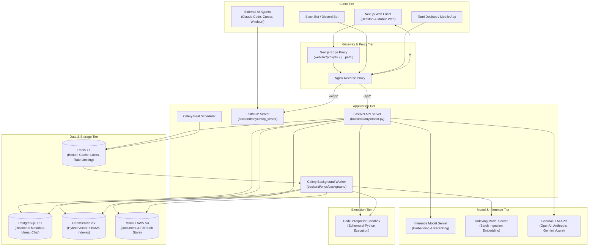
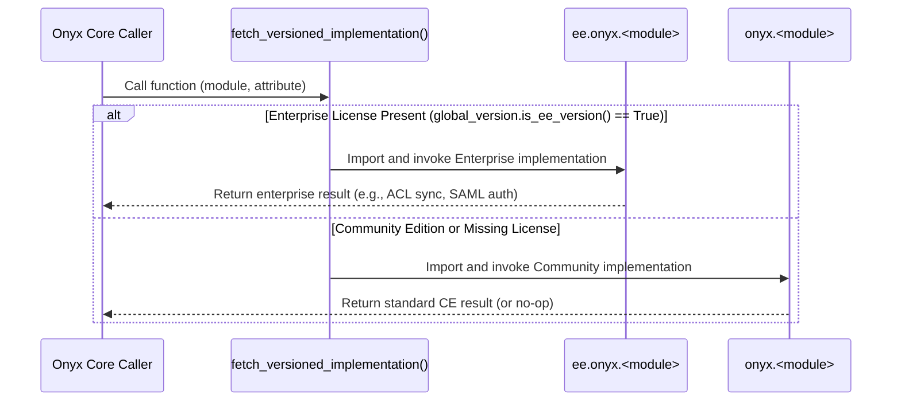

# System Architecture & Component Communication

This document details the high-level architecture of Onyx, explaining how its decoupled services interact to deliver search, RAG, background indexing, and agent execution.

---

## 1. High-Level Architecture Diagram

---

## 2. Tier-by-Tier Breakdown

### A. Client & Edge Gateway Tier
1. **Next.js Frontend (`web/src/proxy.ts`)**:
   - Acts as the first line of defense.
   - Evaluates authentication cookies (`fastapiusersauth`).
   - Rejects unauthenticated requests to protected paths (`/admin`, `/agents`, `/connector`) before they hit the Python backend.
   - Attaches strict Content Security Policy (CSP) and frame-ancestors headers.
2. **Next.js Reverse Proxy Route (`web/src/app/api/[...path]/route.ts`)**:
   - The browser never talks directly to FastAPI on port 8080.
   - All browser requests hit `/api/...` on Next.js (port 3000), which proxies them server-to-server to the backend (`INTERNAL_URL`).
   - Forwards client IP headers (`X-Forwarded-For`), auth cookies, and request contexts.
3. **Nginx Reverse Proxy (`deployment/docker_compose/docker-compose.prod.yml`)**:
   - Handles SSL termination via Let's Encrypt certificates.
   - Routes `/api/` traffic to the API server, `/mcp/` to the FastMCP server, and all remaining traffic to Next.js.

---

### B. Application Tier (FastAPI & Celery)
1. **API Server (`backend/onyx/main.py`)**:
   - Powered by Uvicorn and FastAPI.
   - Operates in a strictly stateless manner.
   - Utilizes dual SQLAlchemy connection pools:
     - Read-write pool (`POSTGRES_API_SERVER_POOL_SIZE`, default 20).
     - Optional read-only replica pool (`POSTGRES_API_SERVER_READ_ONLY_POOL_SIZE`).
   - Serves synchronous and asynchronous endpoints, plus streaming Server-Sent Events (SSE) for chat responses.
2. **Celery Asynchronous Workers (`backend/onyx/background/celery/`)**:
   - Long-running jobs (connector crawls, parsing large PDF batches, embedding generation, index cleaning) run outside the API process.
   - Backed by Redis queues:
     - `celery`: Default general tasks.
     - `indexing`: Document ingestion, chunking, and vector indexing.
     - `pruning`: Garbage collection, expired session cleanup, and deleted document purging.
     - `docfetching`: High-throughput external API connector polling.
3. **Celery Beat Scheduler**:
   - Evaluates schedules defined in `backend/onyx/background/celery/tasks/beat_schedule.py`.
   - Triggers periodic connector update sweeps, permission sync passes, document index health audits, and expired telemetry syncs.

---

### C. Model & Inference Tier
1. **Model Servers (`backend/model_server/main.py`)**:
   - Onyx splits model serving into two instances to prevent ingestion from starving live search:
     - `inference_model_server`: Prioritizes low-latency queries during live user search and reranking.
     - `indexing_model_server`: Consumes large batches of text chunks during connector synchronization.
   - Exposes REST endpoints (`/encoder`, `/rerank`) running local PyTorch / HuggingFace models (e.g., `BAAI/bge-large-en-v1.5`, `cross-encoder/ms-marco-MiniLM-L-6-v2`).
2. **External LLM Gateway (`backend/onyx/llm/`)**:
   - Interfaces with cloud providers (OpenAI, Anthropic Claude, Google Gemini, Azure OpenAI, AWS Bedrock, Cohere, Groq) via LiteLLM.
   - Handles token streaming, custom prompt formatting, temperature/max_tokens management, and per-user cost tracking.

---

### D. Data & Storage Tier
1. **PostgreSQL 15+**:
   - Stores users, hashed passwords, API keys, OAuth tokens, personas (assistants), connector configurations, credentials, chat sessions, message histories, feedback, and document sets.
   - Migrations managed by Alembic (`backend/alembic/`).
2. **OpenSearch 2.x**:
   - Houses the `danswer_chunk` index.
   - Each document chunk contains:
     - `document_id`: Source identifier.
     - `chunk_id`: Monotonically increasing chunk index.
     - `content`: Chunk plain text.
     - `embeddings`: Dense vector float array (k-NN search enabled).
     - `source_type`: Connector origin (e.g., google_drive, slack).
     - `access_control_list`: User and group IDs permitted to read the chunk.
     - `document_sets`: Associated document collections.
3. **Redis 7+**:
   - Acts as Celery message broker and result backend.
   - Implements distributed locks (`backend/onyx/redis/`) to prevent duplicate indexing jobs on identical connector-credential pairs (`cc_pair`).
   - Manages sliding-window rate limiters for authentication and API keys.
4. **MinIO / AWS S3**:
   - Blob storage for user-uploaded chat attachments, files uploaded directly to Onyx, and large raw connector payloads.

---

## 3. Dynamic CE vs EE Code Splitting

Onyx employs a modular dispatch mechanism implemented in `backend/onyx/utils/variable_functionality.py`:

This design allows a single unified repository to compile both open-source and commercial distributions without polluting the core code with `if is_ee:` branches.

