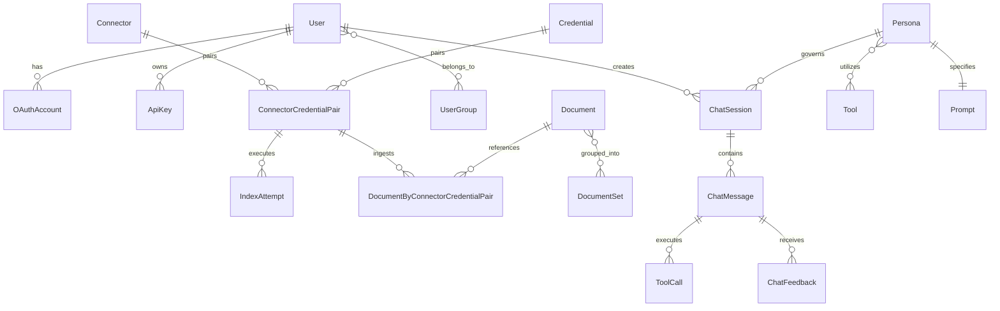

# Database Architecture & Data Models

This document details the relational database design, SQLAlchemy ORM models, migrations, connection management, and multi-tenant schema isolation in Onyx.

---

## 1. Relational Database Overview

Onyx relies on **PostgreSQL 15+** as its authoritative primary data store. The database schema encompasses user identities, access control tokens, external credentials, connector sync state, chat threads, personas, tools, and document metadata.

### Dual Engine Architecture (Sync + Async)
Onyx utilizes both synchronous and asynchronous SQLAlchemy engines:
1. **Synchronous Engine (`backend/onyx/db/engine/sql_engine.py`)**:
   - Used by Celery workers, background sync pollers, and Alembic migrations.
   - Built on `psycopg2-binary`.
   - Thread-safe session factories using scoped sessions.
2. **Asynchronous Engine (`backend/onyx/db/engine/async_sql_engine.py`)**:
   - Used by FastAPI request handlers and streaming chat endpoints.
   - Built on `asyncpg`.
   - Prevents blocking event loops during high-concurrency token streaming and database queries.

Connection pools are explicitly configured:
- Read-Write Pool: `POSTGRES_API_SERVER_POOL_SIZE` (default 20, overflow 10).
- Read-Only Replica Pool: `POSTGRES_API_SERVER_READ_ONLY_POOL_SIZE` (default 10).

---

## 2. Core Entity Relationship Diagram (ERD)

---

## 3. Major Data Models (`backend/onyx/db/models.py`)

### A. Authentication & User Management
- **`User`**:
  Stores user records conforming to `fastapi-users`. Includes email, hashed password, role (`admin`, `basic`, `curator`, `global_curator`), active status, verification timestamp, and organization metadata.
- **`UserGroup` & `UserGroupMember`**:
  Enterprise grouping mechanism. Maps users to group IDs for document permissions, persona sharing, and curated document sets.
- **`ApiKey`**:
  Hashed developer tokens for programmatic API access, scoped by expiration date, user ownership, and role elevation.

### B. Ingestion, Connectors & Documents
- **`Connector`**:
  Defines an external data source type (e.g., `google_drive`, `slack`, `github`), sync frequency, and specific configuration options (JSON blob).
- **`Credential`**:
  Encrypted authentication secrets (OAuth refresh tokens, API keys, service account JSON). Secrets are encrypted at rest using AES-GCM via `backend/onyx/db/credentials.py`.
- **`ConnectorCredentialPair` (`cc_pair`)**:
  The core binding entity that links a `Connector` to a specific `Credential`. Every indexing job, document association, and sync lock operates on a `cc_pair_id`.
- **`IndexAttempt`**:
  Audit ledger recording every sync pass: start time, finish time, status (`in_progress`, `success`, `failed`, `canceled`), total documents indexed, doc fetch duration, and error traces.
- **`Document`**:
  Metadata record of an ingested entity: external source ID, doc link, title, modification timestamp, and document access ACL tokens.

### C. Chat, Personas & Agent Workflows
- **`Persona`**:
  Defines an AI assistant. Specifies system prompt, attached tools (search, web search, code interpreter), associated document sets, temperature, max context tokens, and model overrides.
- **`ChatSession`**:
  A conversation thread associated with a user and a persona. Supports thread branching, description summaries, and incognito mode flags.
- **`ChatMessage`**:
  An individual turn in a conversation (`user`, `assistant`, `system`). Stores raw prompt text, rendered markdown, parent message IDs for branching trees, and attached citations.
- **`ToolCall`**:
  Records tool invocations triggered by the LLM: tool name, input arguments JSON, tool output payload, execution duration, and error flags.

---

## 4. Multi-Tenant Schema Separation

When `MULTI_TENANT=true` is enabled (Enterprise Edition):
1. **Public Schema (`public`)**:
   - Stores tenant registration records, license verification, billing states, and tenant routing lookup tables.
2. **Tenant Schemas (`tenant_<uuid>`)**:
   - Each tenant receives an isolated PostgreSQL schema containing a full mirror of application tables (users, connectors, chats, documents).
3. **Context Variable Routing**:
   - `CURRENT_TENANT_ID_CONTEXTVAR` tracks the active tenant ID per request.
   - Database queries automatically issue `SET search_path TO tenant_<id>, public` within the session transaction.
4. **Independent Migrations**:
   - `backend/alembic/`: Applies migrations to the shared public schema.
   - `backend/alembic_tenants/`: Iterates over every tenant schema and applies tenant-specific structural migrations.

