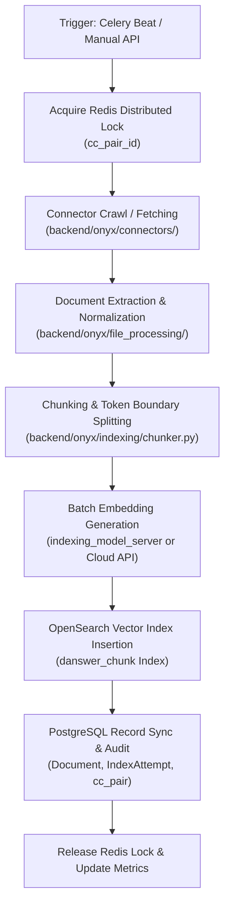

# Document Ingestion Pipeline

This document details how Onyx ingests, extracts, chunks, embeds, indexes, and maintains documents from dozens of external workplace tools.

---

## 1. Pipeline Architecture & Data Flow

The ingestion pipeline runs asynchronously via Celery background workers to handle large-scale crawls without affecting user-facing web responsiveness.



---

## 2. Ingestion Stages in Detail

### Stage 1: Job Scheduling & Lock Acquisition
- **Trigger**: Celery Beat schedules tasks based on connector refresh intervals, or an admin triggers `/api/manage/connector/run-once`.
- **Concurrency Control**: Before executing, the worker acquires a Redis distributed lock keyed by `cc_pair_id` (`backend/onyx/redis/`). If a job is already in progress for that pair, subsequent triggers are skipped to avoid resource contention.
- **IndexAttempt Creation**: A new `IndexAttempt` record is created in PostgreSQL with status `IN_PROGRESS`.

### Stage 2: Document Fetching & State Tracking
- The connector runs its `poll_source()` or `load_from_state()` method.
- **Incremental Sync**: Connectors track a state cursor (e.g., last modified timestamp or change token). On subsequent runs, only documents created or modified after the cursor are fetched.
- **Batched Generator**: Connectors yield batches of `SlimDocument` or `Document` objects containing raw text, metadata, external links, and upstream access control lists (user emails, group IDs).

### Stage 3: File Processing & Text Extraction (`backend/onyx/file_processing/`)
- Ingested files (PDFs, Word docs, PowerPoint presentations, HTML pages) undergo structured extraction:
  - **PDF Extraction**: Uses `pypdf`, `pdfminer.six`, or OCR fallbacks to extract text while preserving headings and tabular structures.
  - **HTML Extraction**: Cleans boilerplates, navigation headers, and scripts via BeautifulSoup, preserving semantic headers (`<h1>`-`<h6>`).
  - **Code & Markdown**: Preserves indentation and fenced code blocks.

### Stage 4: Chunking (`backend/onyx/indexing/chunker.py`)
- Standard LLM context windows require documents to be split into coherent chunks:
  - **Default Chunk Size**: Configured via `CHUNK_SIZE` (default: 512 tokens).
  - **Overlap**: Configured via `CHUNK_OVERLAP` (default: 48 tokens) to prevent losing context across chunk boundaries.
  - **Semantic Splitting**: Chunks break on paragraph, sentence, and section boundaries rather than arbitrary token cuts.
  - **Title Prepending**: Injected metadata (document title, source path, section header) is prepended to each chunk so isolated chunks retain topical context during search.

### Stage 5: Dense Vector Embedding (`backend/onyx/indexing/embedder.py`)
- Chunks are assembled into batches and dispatched to the embedding provider:
  - **Local Model Server**: Sends HTTP POST requests to `indexing_model_server` (running models like `BAAI/bge-large-en-v1.5` or `nomic-embed-text`).
  - **Cloud APIs**: Dispatches parallel asynchronous requests to OpenAI (`text-embedding-3-large`), Cohere, or Voyage AI.
- Returns float vectors (e.g., 1024-dimensional or 1536-dimensional arrays).

### Stage 6: OpenSearch Indexing (`backend/onyx/document_index/opensearch/`)
- Each chunk is indexed into OpenSearch under the `danswer_chunk` index.
- A single OpenSearch chunk document contains:
  ```json
  {
    "document_id": "google_drive__1a2b3c4d",
    "chunk_id": 0,
    "content": "Quarterly earnings report summary...",
    "title": "Q3 2026 Earnings",
    "source_type": "google_drive",
    "source_logical_type": "file",
    "embeddings": [0.012, -0.045, 0.089, ...],
    "access_control_list": ["user:alex@company.com", "group:finance"],
    "document_sets": ["Internal Reports", "Finance 2026"],
    "metadata": {"department": "Finance", "year": "2026"}
  }
  ```

### Stage 7: Deletion & Index Pruning (`backend/onyx/background/celery/tasks/pruning/`)
- When documents are removed from upstream sources (e.g., a file deleted in Google Drive):
  1. The connector run identifies documents missing from the upstream crawl.
  2. The worker issues an OpenSearch deletion query matching `document_id`.
  3. Associated metadata and junction records in PostgreSQL are removed or flagged as deleted.

