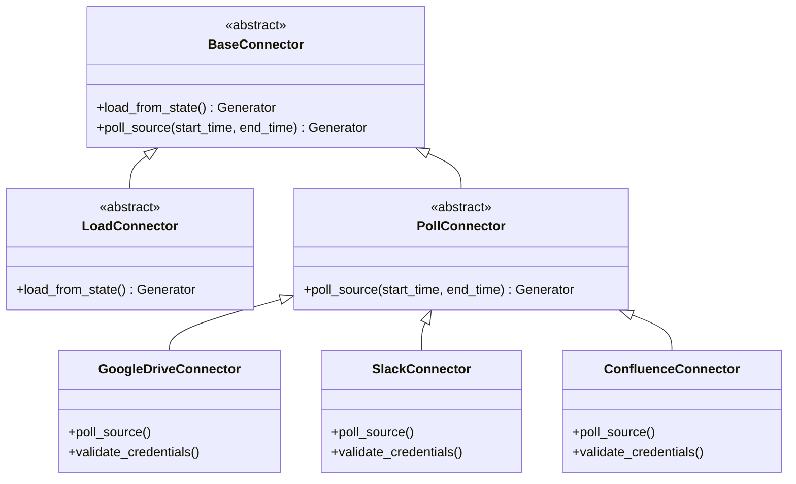

# Connectors & External Integrations

This document covers Onyx's connector framework, supported data sources, credential encryption, permission handling, and how to build a custom connector.

---

## 1. Connector Framework Architecture

Onyx connects to third-party tools via a unified, object-oriented connector interface located in `backend/onyx/connectors/interfaces.py`.



### Connector Types:
1. **`PollConnector`**:
   - Designed for sources that support incremental querying based on timestamps (e.g., Slack, GitHub, Jira, Gmail).
   - Ingests updates occurring between `start_time` and `end_time`.
2. **`LoadConnector`**:
   - Designed for hierarchical or state-based sources (e.g., Google Drive folder trees, Confluence spaces, Web crawls).
   - Traverses document trees and yields state cursors to resume interrupted syncs.

---

## 2. Supported Data Sources (40+ Connectors)

| Category | Supported Connectors |
| :--- | :--- |
| **Documents & Wikis** | Google Drive, Confluence, Notion, Microsoft SharePoint, Microsoft OneDrive, Coda, Slab, BookStack, Outline, GitBook, Guru, Document360, Drupal Wiki |
| **Communication** | Slack, Discord, Microsoft Teams, Zulip, Discourse, Gmail, Microsoft Outlook, XenForo |
| **Project & Issues** | Jira, Linear, GitHub (Issues, PRs, Code), GitLab, Bitbucket, Asana, ClickUp, Productboard, YouTrack, TestRail |
| **CRM & Customer** | Salesforce, Zendesk, Freshdesk, HubSpot, Gong, Highspot, Fireflies.ai, Loopio |
| **Cloud Storage** | AWS S3 / Azure Blob / MinIO, Box, Egnyte, Local File Upload |
| **Web & Knowledge** | Recursive Web Crawler, Single URL Scraper, Wikipedia, MediaWiki |

---

## 3. Credential Encryption & Security

External credentials (OAuth refresh tokens, client secrets, API tokens, service account JSON private keys) are never stored in plaintext.

1. **Encryption Mechanism (`backend/onyx/db/credentials.py`)**:
   - Uses AES-GCM 256-bit authenticated encryption.
   - Encryption keys are derived from `ENCRYPTION_KEY_SECRET` in environment variables.
   - Encryption occurs transparently before writing to PostgreSQL, and decryption occurs only in worker memory when establishing API connections.
2. **OAuth2 Token Refresh Lifecycle (`backend/onyx/auth/oauth_refresher.py`)**:
   - For services using OAuth2 (Google Drive, Slack, GitHub, Salesforce), Celery tasks inspect token expiration timestamps before running.
   - If a token is expired or within 5 minutes of expiration, the worker issues an asynchronous refresh call to the provider's token endpoint and updates the database record.

---

## 4. How to Implement a Custom Connector

Adding a new connector to Onyx involves three simple steps:

### Step 1: Define Connector Class (`backend/onyx/connectors/<source_name>/connector.py`)
Inherit from `PollConnector` or `LoadConnector` and implement `poll_source`:

```python
from collections.abc import Generator
from datetime import datetime
from onyx.connectors.interfaces import PollConnector
from onyx.connectors.models import Document, Section

class CustomAppConnector(PollConnector):
    def __init__(self, api_key: str, base_url: str):
        self.api_key = api_key
        self.base_url = base_url

    def poll_source(
        self, start_time: datetime, end_time: datetime
    ) -> Generator[Document, None, None]:
        # 1. Fetch raw items from external API
        items = self._fetch_updated_items(start_time, end_time)
        
        # 2. Yield normalized Document objects
        for item in items:
            yield Document(
                id=f"custom_app__{item['id']}",
                sections=[Section(text=item['body'])],
                source="custom_app",
                semantic_identifier=item['title'],
                metadata={"author": item['author_name']},
                doc_updated_at=item['updated_at'],
                primary_owners=[item['owner_email']],
            )
```

### Step 2: Register Connector in Factory (`backend/onyx/connectors/factory.py`)
Add the connector to the registry dictionary with its configuration schema and human-readable label.

### Step 3: Add Frontend Form Configuration (`web/src/lib/connectors/connectors.ts`)
Add the connector configuration UI schema so administrators can input API credentials, configure synchronization frequencies, and trigger syncs from the web dashboard.

