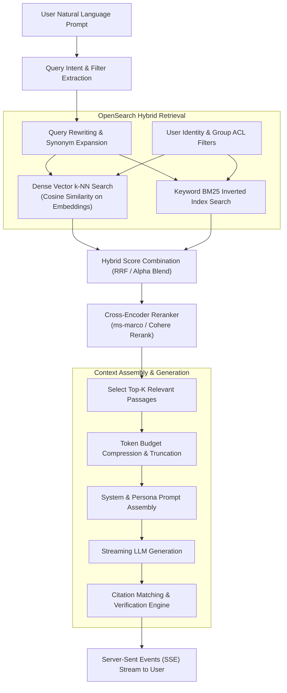

# Search & RAG (Retrieval-Augmented Generation) Pipeline

This document explains the search architecture, hybrid retrieval algorithm, access control enforcement at query time, cross-encoder reranking, and citation generation in Onyx.

---

## 1. Retrieval & RAG Architecture



---

## 2. Query Pipeline Stages

### Stage 1: Intent Evaluation & Query Rewriting
- Located in `backend/onyx/tools/tool_implementations/search/search_tool.py`.
- **Query Classification**: Determines whether the user prompt requires document retrieval, general world knowledge (web search), Python execution, or direct conversational chat.
- **Filter Extraction**: Extracts temporal constraints ("documents from last week"), source filters ("only search Slack and Jira"), and document set constraints.
- **Hypothetical Document Embeddings (HyDE)** (optional): Generates a hypothetical answer with an LLM and embeds the answer to retrieve semantically matching passages.

### Stage 2: OpenSearch Hybrid Search
Onyx performs hybrid search against OpenSearch, combining sparse keyword matching and dense vector similarity:

1. **BM25 Keyword Search**:
   Matches exact terms, acronyms, code identifiers, filenames, and phrases across chunk content and titles.
2. **Dense Vector Search (k-NN)**:
   Uses the query embedding to perform approximate nearest-neighbor search (`hnsw` or `ivf` algorithms) to capture semantic synonyms and conceptual relevance.
3. **ACL Filter Injection (Security Enforcement)**:
   Search queries are never run across the whole index without filtering. The user's authenticated email and group memberships are appended as mandatory `bool.filter` terms:
   ```json
   {
     "bool": {
       "filter": [
         {
           "terms": {
             "access_control_list": ["user:john@company.com", "group:engineering", "public"]
           }
         }
       ]
     }
   }
   ```
   This ensures that no unauthorized chunks can leak into the candidate pool.

### Stage 3: Score Normalization & Hybrid Combination
Raw BM25 scores and cosine vector similarity scores exist on incompatible scales. Onyx merges them using **Reciprocal Rank Fusion (RRF)** or weighted alpha combination:

$$\text{Score} = \alpha \cdot \text{DenseScore} + (1 - \alpha) \cdot \text{BM25Score}$$

Default $\alpha$ is tuned to $0.5$ (balanced hybrid).

### Stage 4: Cross-Encoder Reranking
- The top 50–100 candidates from hybrid retrieval are dispatched to the reranking model (`inference_model_server` or Cohere Rerank).
- While bi-encoders embed query and document independently, the **Cross-Encoder** evaluates the full query-document pair simultaneously:
  $$\text{Relevance} = \text{Model}(\text{Query} \oplus \text{Passage})$$
- This produces high-precision relevance scores, filtering out irrelevant chunks that happened to share keywords.

---

## 3. Context Assembly & Inline Citations

### Context Window Token Budgeting (`backend/onyx/chat/compression.py`)
- Given the persona's configured context limit (e.g., 8k, 16k, or 32k tokens), Onyx allocates token budgets:
  - System prompt & persona instructions: Reserved.
  - Recent chat history: Reserved.
  - Retrieved documents: Top-ranked passages are packed greedily until the document token budget is exhausted.

### Citation Processor (`backend/onyx/chat/citation_processor.py`)
- Each injected passage is labeled with a bracketed citation reference (e.g., `[[1]]`, `[[2]]`).
- As the LLM streams its response, the citation processor:
  1. Detects citation markers in the token stream.
  2. Maps each marker to the exact source document ID, title, URL, and excerpt.
  3. Emits citation metadata packets over SSE so the frontend highlights clickable references next to the text.

