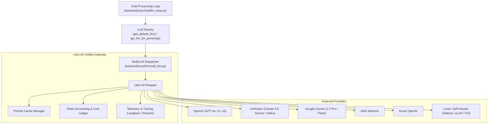

# AI & LLM Integrations

This document details the multi-LLM gateway, supported providers, model catalog, cost tracking, tool calling, and observability integrations in Onyx.

---

## 1. Multi-LLM Gateway Architecture

Onyx abstracts external model providers through a unified gateway located in `backend/onyx/llm/multi_llm.py` and `factory.py`, built upon the LiteLLM library.

---

## 2. Model Catalog & Capabilities

Onyx maintains a dynamic model capability database in `backend/onyx/llm/model_catalog.py` and `model_capabilities.py`:

1. **Feature Detection**:
   - Automatically determines whether a chosen model supports native tool calling, structured JSON output, vision/multimodal image inputs, system messages, or streaming.
   - For models without native function calling support, Onyx transparently activates prompt-based tool calling with JSON Schema fallback parsing.
2. **Context Window Limits**:
   - Tracks context window limits (e.g., 128k for GPT-4o, 200k for Claude 3.5 Sonnet, 1M for Gemini 1.5 Pro) and adjusts document compression budgets accordingly.
3. **Model Configuration Hierarchy**:
   - System Default Model (set by admin).
   - Persona Model Override (assistant creator can specify a specialized model).
   - User Session Override (user can select an approved model from the UI dropdown).

---

## 3. Tool Calling & Function Execution

When an assistant has tools attached (Search, Web Search, Python Code Interpreter, MCP tools):

1. **Schema Generation (`backend/onyx/tools/tool_constructor.py`)**:
   - Pydantic models for tool parameters are converted into standard JSON Schema specifications.
2. **Provider Schema Translation (`backend/onyx/llm/tool_parsing.py`)**:
   - Formats schemas into OpenAI tool calling payloads or Anthropic tool specifications.
3. **Streamed Tool Call Parsing**:
   - Emits incremental tool arguments over SSE (`tool_call_args_streaming.py`) so users see tool actions in real time ("Searching Google Drive for Q3 Report...").
4. **Tool Execution & Loop Continuation**:
   - The tool runs in a safe execution handler (`backend/onyx/tools/tool_runner.py`).
   - The tool result is packaged into a `tool` role message and fed back into the LLM loop for final synthesis.

---

## 4. Cost Tracking & Usage Quotas

Onyx tracks token usage and financial cost per request in `backend/onyx/llm/cost.py`:

- **Pricing Table**: Maintained in `backend/onyx/llm/price_table/` with input token, output token, and cached token rates for hundreds of models.
- **Transactional Ledger**: Each completed chat turn logs prompt tokens, completion tokens, and dollar cost into `llm_usage` in PostgreSQL.
- **Usage Limits (Enterprise)**:
  - Daily, weekly, or monthly token/dollar quotas per user or user group.
  - Rate limiting that blocks requests before reaching upstream provider API quotas.

---

## 5. Observability & Tracing

Integrated observability allows administrators to inspect complete LLM reasoning chains:

- **Langfuse Integration**: Full trace of prompt templates, retrieved chunks, token counts, and latency.
- **Arize Phoenix / OpenTelemetry**: Export distributed traces to OpenTelemetry collectors (`backend/onyx/tracing/setup.py`).
- **Audit Logging**: Enterprise audit logs record user queries, model names, IP addresses, and document IDs referenced.

