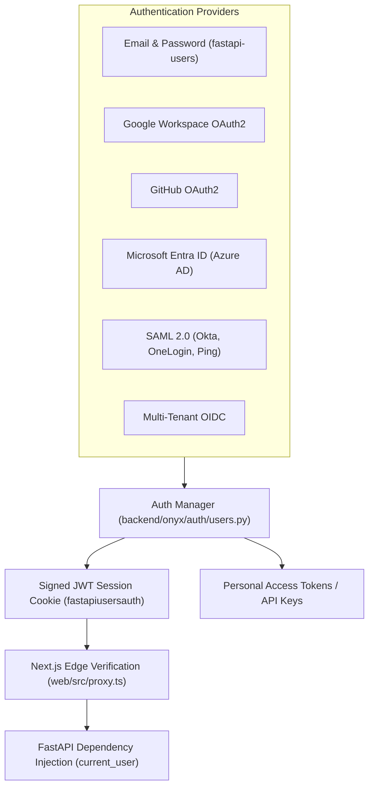
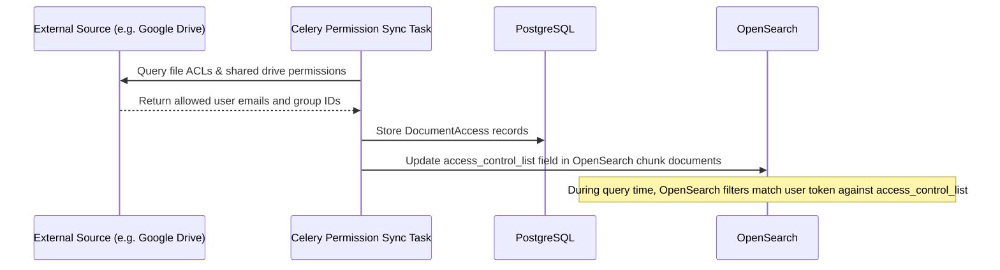

# Authentication, Authorization & Security Architecture

This document covers user authentication protocols, role-based access control (RBAC), document-level permissions, encryption, and defense-in-depth security measures.

---

## 1. Authentication Architecture

Onyx supports multiple authentication backends (`backend/onyx/auth/`):

### Supported Authentication Backends:
1. **Local Authentication**:
   - Built on `fastapi-users` with bcrypt password hashing.
   - Includes optional email verification and password reset flows via SMTP.
2. **OAuth2 (Google, GitHub, Microsoft)**:
   - Implements PKCE (Proof Key for Code Exchange) flows for authorization code exchange.
   - Captures user profile claims (email, name, picture) upon successful callback.
3. **Enterprise SSO (SAML 2.0 & OIDC)**:
   - Configurable per-tenant in Enterprise Edition.
   - Validates SAML XML assertions using provider certificates.
   - Maps enterprise IdP groups to Onyx user groups automatically upon login.

---

## 2. Session Management & API Keys

### A. HTTP-Only JWT Cookies
- Browser sessions utilize encrypted, HTTP-only, `SameSite=Lax` cookies named `fastapiusersauth`.
- Tokens are signed with `USER_AUTH_SECRET` using HS256/RS256 algorithms.
- Browser JavaScript cannot read the cookie directly, mitigating Cross-Site Scripting (XSS) session theft.

### B. Personal Access Tokens (PAT) & API Keys
- Programmatic requests pass `Authorization: Bearer <API_KEY>`.
- Hashes are stored in PostgreSQL (`api_key` table); the raw secret is shown once upon generation.
- Keys can be assigned expiration timestamps and scoped permissions.

---

## 3. Role-Based Access Control (RBAC)

Onyx defines four core user roles (`backend/onyx/auth/permissions.py`):

| Role | Permissions |
| :--- | :--- |
| **`admin`** | Full platform control: manage connectors, configure LLMs, assign roles, view system metrics, edit billing, configure SSO. |
| **`curator`** | Scoped admin: manages specific document sets, personas, and connectors assigned to their designated user groups. |
| **`global_curator`** | Can create and manage all document sets, personas, and tools across the workspace without full system administration privileges. |
| **`basic`** | End user: query knowledge, use assigned personas, manage personal chat history, and upload private files. |

---

## 4. Document-Level Access Control & Permission Sync

One of Onyx's most powerful enterprise capabilities is **inherited access control**:

- When an employee searches Onyx, they cannot see documents they do not have permission to view in the original system (e.g., restricted HR or Finance folders in Google Drive).
- **Background Permission Sync**: A dedicated Celery worker periodically audits upstream ACL changes and updates OpenSearch indices without requiring a full re-ingestion of document text.

---

## 5. Security Hardening & Edge Defenses

1. **Content Security Policy (CSP) & Frame Ancestors (`web/src/proxy.ts`)**:
   - Strict `frame-ancestors` prevents clickjacking by restricting origins permitted to iframe Onyx.
   - Strict script-src and connect-src policies prevent unauthorized script injection.
2. **Credential Encryption at Rest**:
   - AES-GCM 256-bit encryption for all stored connector tokens and third-party secrets.
3. **CAPTCHA Protection**:
   - Cloudflare Turnstile / Google reCAPTCHA middleware on public authentication endpoints.
4. **Disposable Email Blocking**:
   - Automated check against disposable email domains during signup (`disposable_email_validator.py`).
5. **Rate Limiting**:
   - Redis sliding-window limiters guard against brute-force password guessing and API key exhaustion.

