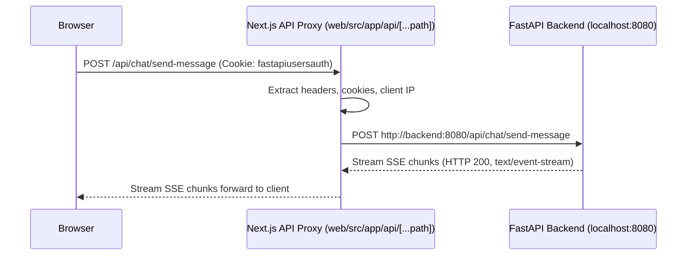

# Frontend Architecture & Client State Management

This document details the Next.js 16 frontend application, App Router architecture, UI state management, Server-Sent Events (SSE) streaming engine, and API proxy layer.

---

## 1. Frontend Technology Stack

| Layer | Technologies |
| :--- | :--- |
| **Framework** | Next.js 16 (App Router), React 19, TypeScript |
| **Styling & Design** | Tailwind CSS, Radix UI Primitives, Lucide React Icons |
| **State Management** | React Context API, Custom Hooks, SWR for data fetching |
| **Streaming** | Native `ReadableStream` consumer with SSE packet decoder |
| **Form Handling** | React Hook Form, Zod schema validation |
| **Testing** | Jest, React Testing Library, Playwright E2E suites |

---

## 2. Next.js App Router Structure

The application routes are organized under `web/src/app/`:

```
web/src/app/
├── admin/                    # Admin Dashboard Pages
│   ├── connectors/           # Connector management, credential setup, sync logs
│   ├── document-sets/        # Document set curation and access scoping
│   ├── models/               # LLM provider configuration & embedding model selection
│   ├── personas/             # Assistant customization & prompt engineering
│   ├── tools/                # Built-in and custom tool registration
│   ├── users/                # User management, role elevation, user groups
│   └── analytics/            # Token consumption, search quality, query metrics
│
├── api/                      # Next.js API Routes (Server-Side Proxy)
│   ├── [...path]/route.ts    # Catch-all reverse proxy forwarding to FastAPI backend
│   └── chat/                 # Specialized chat proxy handlers
│
├── app/                      # Primary Chat Experience (/app)
│   ├── page.tsx              # Chat interface (message list, input box, sidebar)
│   └── layout.tsx            # Authenticated session boundary & sidebar layout
│
├── auth/                     # Authentication Flow Pages
│   ├── login/                # Email/password & SSO login page
│   ├── signup/               # Registration page
│   ├── reset-password/       # Password recovery flow
│   └── callback/             # OAuth2 / SAML authentication callback handler
│
└── craft/                    # Craft Agent Workbench (Interactive sandboxes)
```

---

## 3. The API Reverse Proxy Layer (`web/src/app/api/[...path]/route.ts`)

To eliminate CORS issues, cookie security vulnerabilities, and direct exposure of the backend port, all browser requests target `/api/*` on the Next.js origin.



- **Authentication Transparency**: The proxy forwards `fastapiusersauth` cookies and client IP headers (`X-Forwarded-For`).
- **Stream Forwarding**: Responses with `content-type: text/event-stream` are piped directly using web streams, ensuring zero latency overhead during LLM token streaming.

---

## 4. Streaming SSE Client Engine

The real-time conversational streaming engine is implemented in `web/src/lib/chat/fetchStreaming.ts` and managed via the `useChatStream` hook:

```typescript
// Conceptual SSE chunk processing
const response = await fetch("/api/chat/send-message", { ... });
const reader = response.body.getReader();
const decoder = new TextDecoder();

while (true) {
  const { value, done } = await reader.read();
  if (done) break;
  const chunk = decoder.decode(value);
  // Parse lines: data: {"type": "text", "content": "Hello"}
  const packets = parseSSEPackets(chunk);
  packets.forEach(packet => {
    switch (packet.type) {
      case "text":
        appendMessageToken(packet.content);
        break;
      case "citation":
        attachCitationBadge(packet.citation);
        break;
      case "tool_call":
        displayToolExecutionStatus(packet.tool_name, packet.status);
        break;
      case "error":
        displayErrorToast(packet.error_message);
        break;
    }
  });
}
```

### Packet Protocol Types:
1. **`text`**: Incremental markdown tokens generated by the LLM.
2. **`citation`**: Source document links with snippet highlights and relevancy ranking.
3. **`tool_call`**: Name and arguments of tools invoked during the reasoning turn.
4. **`tool_result`**: Output of tool execution (e.g., search results, Python output).
5. **`message_id`**: Final database identifier for the newly committed turn.

---

## 5. UI Architecture & Theming

- **Tailwind CSS & CSS Variables**: Global styles in `web/src/app/globals.css` define theme tokens (`--background`, `--foreground`, `--primary`, `--muted`).
- **Dark / Light Modes**: Managed via `next-themes` with zero flicker during initial hydration.
- **Accessible Primitives**: Built on Radix UI to guarantee full keyboard navigation, screen reader accessibility, and ARIA compliance.

