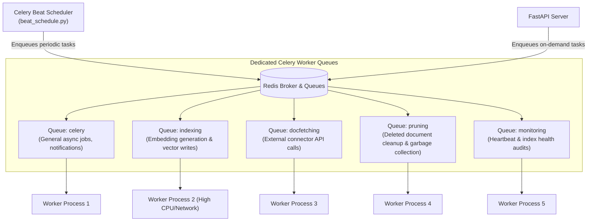

# Background Jobs, Queues & Infrastructure

This document details Celery background worker queues, Celery Beat periodic schedules, Redis distributed locks, and production infrastructure topologies.

---

## 1. Background Worker Architecture

Heavy, long-running, or recurring operations run asynchronously via **Celery 5.x**, backed by **Redis 7+** as the message broker.

---

## 2. Queue Partitioning & Worker Roles

To prevent slow document ingestion from delaying critical tasks, workers are segmented across dedicated queues:

1. **`indexing`**:
   - Handles text tokenization, chunking, batched calls to embedding model servers, and bulk indexing into OpenSearch.
   - Resource profile: High CPU, network-intensive.
2. **`docfetching`**:
   - Manages API calls to external data sources (Google Drive, Slack, Confluence).
   - Rate-limited and retry-tolerant (handles 429 Too Many Requests with exponential backoff).
3. **`pruning`**:
   - Scans for documents deleted upstream and executes chunk deletions in OpenSearch.
4. **`celery` (Default)**:
   - Processes user-initiated file uploads, administrative notifications, LLM token logging, and feedback auditing.

---

## 3. Celery Beat Periodic Schedules (`backend/onyx/background/celery/tasks/beat_schedule.py`)

Celery Beat periodically enqueues maintenance routines:

| Task Name | Interval | Purpose |
| :--- | :--- | :--- |
| `check-for-connector-runs` | Every 30 seconds | Evaluates whether any connector is due for an incremental or full sync pass. |
| `audit-document-index` | Every 5 minutes | Inspects OpenSearch cluster health, shard counts, and unassigned shards. |
| `sync-permissions` | Every 10 minutes | Polls upstream access control lists (Google Workspace, Confluence) and updates ACL tokens. |
| `prune-stale-index-attempts` | Every 15 minutes | Cleans up orphaned or aborted index attempts stuck in `IN_PROGRESS` due to worker crashes. |
| `purge-expired-sessions` | Daily | Deletes expired user sessions and temporary uploaded files from blob storage. |

---

## 4. Distributed Concurrency & Locking

To prevent race conditions—such as two workers attempting to crawl the same Google Drive account simultaneously:

- **Redis Distributed Locks (`backend/onyx/redis/`)**:
  - Implements Redis-based locks with explicit Time-To-Live (TTL) expiration.
  - Key format: `lock:cc_pair:<cc_pair_id>`.
  - If a worker crashes, the TTL expires automatically, unlocking the connector without requiring manual database intervention.

---

## 5. Deployment Topologies & Sizing

### A. Minimal Single-Node Topology (Docker Compose)
- **Target**: Small teams (< 50 users), evaluating Onyx.
- **Components**: API server, background worker, web server, Postgres, OpenSearch, Redis, local model server.
- **Recommended Hardware**: 4 vCPUs, 16 GB RAM, 100 GB SSD storage.

### B. High-Availability Enterprise Topology (Kubernetes / Helm)
- **Target**: Large enterprise deployments (> 500 users, millions of documents).
- **Topology**:
  - **API Server Pods**: Horizontally autoscaled based on HTTP request concurrency.
  - **Celery Worker Pods**: Partitioned into `indexing-workers` and `fetching-workers`, autoscaling on Redis queue depth.
  - **Database**: Managed Amazon Aurora PostgreSQL (Multi-AZ with read replica).
  - **Search**: Managed Amazon OpenSearch Service cluster (Multi-node with dedicated master nodes).
  - **Caching**: Managed Amazon ElastiCache Redis cluster.
  - **Storage**: AWS S3 bucket for document blobs.
  - **Model Inference**: Dedicated GPU worker node (NVIDIA T4 or A10G) running the model server container with TensorRT/ONNX optimizations.

