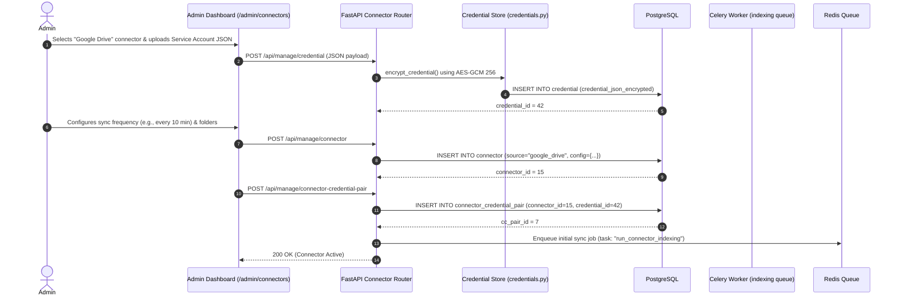
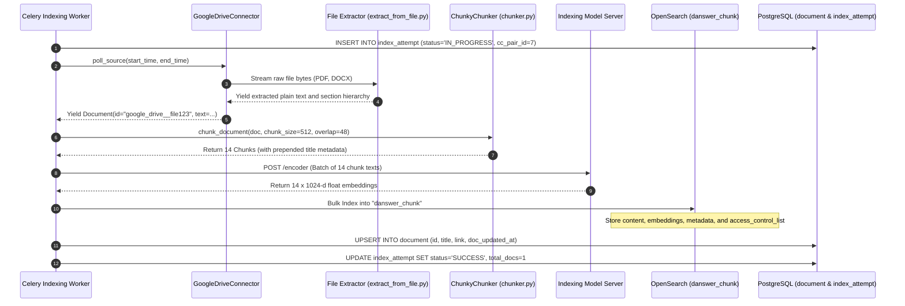
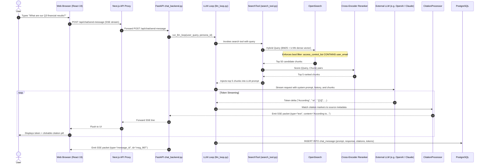
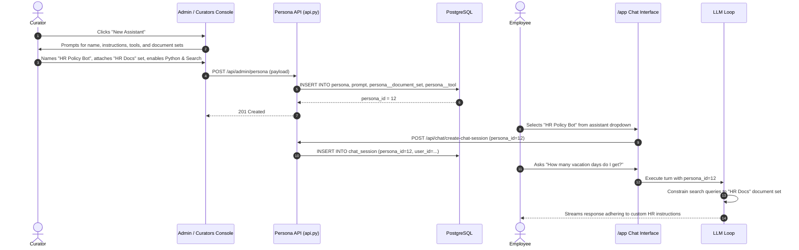
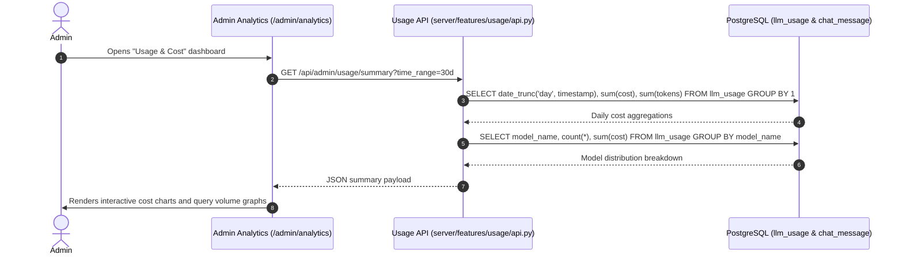

# Major User Journeys & End-to-End Code Traces

This document traces six core user journeys through Onyx, following execution flow across the frontend, Next.js proxy, FastAPI API server, Celery background workers, PostgreSQL, and OpenSearch.

---

## Journey 1: User Registration & Authentication

```mermaid
sequenceDiagram
    autonumber
    actor User
    participant Browser as Next.js Web App
    participant Edge as Edge Proxy (web/src/proxy.ts)
    participant NextAPI as Next.js API Proxy
    participant Backend as FastAPI (backend/onyx/main.py)
    participant Auth as UserManager (backend/onyx/auth/users.py)
    participant DB as PostgreSQL (user table)

    User->>Browser: Enters email and password on /auth/register
    Browser->>NextAPI: POST /api/auth/register
    NextAPI->>Backend: Forward POST /api/auth/register
    Backend->>Auth: on_after_register() -> validate password & hash via bcrypt
    Auth->>DB: INSERT INTO "user" (email, hashed_password, role, is_active)
    DB-->>Auth: User record created (first user automatically becomes 'admin')
    Backend-->>NextAPI: 201 Created
    NextAPI-->>Browser: Registration Success

    User->>Browser: Enters credentials on /auth/login
    Browser->>NextAPI: POST /api/auth/jwt/login
    NextAPI->>Backend: Forward POST /api/auth/jwt/login
    Backend->>Auth: authenticate() -> verify bcrypt hash
    Auth->>Backend: Generate JWT token signed with USER_AUTH_SECRET
    Backend-->>NextAPI: Set-Cookie: fastapiusersauth=<JWT>; HttpOnly; SameSite=Lax
    NextAPI-->>Browser: 200 OK + Set-Cookie
    Browser->>Edge: Navigate to /app (with auth cookie)
    Edge->>Edge: Validate cookie presence -> Allow access
    Browser->>User: Display Chat Workbench
```

---

## Journey 2: Administrator Connects Google Drive



---

## Journey 3: Ingestion, Chunking, Embedding & Indexing



---

## Journey 4: User Asks a Question (Search, RAG, Citations & Streaming)



---

## Journey 5: Creating & Using a Custom AI Agent (Persona)



---

## Journey 6: Administrative Auditing & Usage Tracking



