# Feature Dependency Map & Shared Components

This document maps the architectural prerequisites and dependencies between Onyx features, identifying foundational infrastructure, shared components, and implementation ordering.

---

## 1. Feature Dependency Hierarchy Diagram

```mermaid
flowchart TD
    %% Layer 1: Core Foundation
    subgraph Foundation["Layer 1: Foundational Infrastructure"]
        Postgres[("PostgreSQL\n(Relational Store)")]
        RedisStore[("Redis\n(Broker, Locks, Cache)")]
        OpenSearchStore[("OpenSearch\n(Vector & Keyword Engine)")]
        AuthEngine["Authentication & Identity\n(JWT, Users, Roles)"]
        CryptoEngine["Credential Encryption\n(AES-GCM 256)"]
        LLMGateway["LiteLLM Gateway\n(Model Dispatch & Cost Ledger)"]
    end

    %% Layer 2: Core Pipelines
    subgraph CorePipelines["Layer 2: Core Processing Engines"]
        CeleryFramework["Celery Task Framework\n(Queues, Beat Scheduler)"]
        EmbeddingEngine["Embedding & Reranking Engine\n(Model Server / Cloud)"]
        FileExtraction["File Extraction & Parsing\n(PDF, DOCX, HTML)"]
        ChunkerModule["Semantic Chunker\n(512-token with Overlap)"]
        StreamingProtocol["SSE Streaming Engine\n(Server-Sent Events)"]
    end

    %% Layer 3: Knowledge & Retrieval
    subgraph Knowledge["Layer 3: Knowledge & Retrieval"]
        ConnectorFramework["40+ Application Connectors"]
        IngestionPipeline["Asynchronous Ingestion Pipeline"]
        HybridSearch["OpenSearch Hybrid Search\n(k-NN + BM25 + ACL Filter)"]
        RerankerModule["Cross-Encoder Reranker"]
        DocSetManager["Document Set Manager"]
    end

    %% Layer 4: AI & Agent Services
    subgraph AgentServices["Layer 4: Agent & Tool Services"]
        ToolRunner["Tool Execution Framework\n(Schema Translation & Invoker)"]
        SearchTool["Internal Search Tool"]
        WebSearchTool["Live Web Search Tool"]
        PythonSandbox["Code Interpreter Sandbox"]
        MCPClient["Model Context Protocol Client"]
        PersonaEngine["Persona & Prompt Manager"]
    end

    %% Layer 5: End User Surfaces
    subgraph UserSurfaces["Layer 5: End-User Application Surfaces"]
        ChatUI["Chat & Search Interface (/app)"]
        DeepResearchAgent["Deep Research Autonomous Agent"]
        SlackBotApp["Slack & Discord Bots"]
        AdminDashboard["Admin Console & Analytics"]
        DeveloperAPI["Developer REST API / OpenAPI"]
    end

    %% Dependencies
    AuthEngine --> Postgres
    CryptoEngine --> Postgres
    CeleryFramework --> RedisStore
    EmbeddingEngine --> OpenSearchStore

    ConnectorFramework --> CryptoEngine
    ConnectorFramework --> CeleryFramework
    ConnectorFramework --> FileExtraction

    IngestionPipeline --> ConnectorFramework
    IngestionPipeline --> ChunkerModule
    IngestionPipeline --> EmbeddingEngine
    IngestionPipeline --> OpenSearchStore

    HybridSearch --> OpenSearchStore
    HybridSearch --> AuthEngine
    HybridSearch --> EmbeddingEngine
    RerankerModule --> HybridSearch

    DocSetManager --> IngestionPipeline
    DocSetManager --> Postgres

    SearchTool --> HybridSearch
    SearchTool --> RerankerModule

    ToolRunner --> LLMGateway
    ToolRunner --> SearchTool
    ToolRunner --> WebSearchTool
    ToolRunner --> PythonSandbox
    ToolRunner --> MCPClient

    PersonaEngine --> ToolRunner
    PersonaEngine --> DocSetManager
    PersonaEngine --> LLMGateway

    ChatUI --> StreamingProtocol
    ChatUI --> PersonaEngine
    ChatUI --> AuthEngine

    DeepResearchAgent --> PersonaEngine
    DeepResearchAgent --> SearchTool
    DeepResearchAgent --> WebSearchTool

    SlackBotApp --> PersonaEngine
    DeveloperAPI --> PersonaEngine
    AdminDashboard --> Postgres
    AdminDashboard --> IngestionPipeline
```

---

## 2. Shared Component Analysis

Several critical subsystems serve as cross-cutting dependencies across the entire product:

### 1. The PostgreSQL Relational Database
- **Consumers**: Auth, Chat Persistence, Connector Configurations, Persona Definitions, Tool Registrations, Usage Auditing, Document Metadata.
- **Role**: Authoritative system of record. Every background task, user request, and configuration change reads from or writes to PostgreSQL.

### 2. The LiteLLM Gateway (`backend/onyx/llm/multi_llm.py`)
- **Consumers**: Interactive Chat, Query Intent Classifier, Document Summarizer, Deep Research, Auto-Titling, Slackbot, Discord Bot.
- **Role**: Single interface for streaming tokens, caching prompts, mapping function-calling schemas, and tracking per-user financial costs.

### 3. The Hybrid OpenSearch Index (`danswer_chunk`)
- **Consumers**: Internal Search Tool, Deep Research, Document Set Manager, Ingestion Pipeline, Pruning Task.
- **Role**: High-throughput retrieval plane storing vector embeddings, BM25 inverted indexes, and access control lists.

### 4. Celery Task Queue Framework
- **Consumers**: Connector Polling, Document Parsing, Embedding Batches, Index Pruning, Upstream Permission Sync, Slack Webhook Processing.
- **Role**: Asynchronous execution fabric that keeps the user-facing web tier completely responsive.

---

## 3. Implementation Prerequisites & Independence

| Feature | Can Implement Independently? | Mandatory Foundational Prerequisites |
| :--- | :--- | :--- |
| **Basic Local Auth** | **Yes** | PostgreSQL |
| **LLM Gateway & Basic Chat** | **Yes** | FastAPI, PostgreSQL, LiteLLM, Next.js UI |
| **Tool Calling Framework** | No | LLM Gateway, Tool Runner |
| **Custom Personas** | No | PostgreSQL, LLM Gateway, Tool Runner |
| **Document Ingestion** | No | PostgreSQL, Redis, Celery, File Extractors, OpenSearch |
| **Connectors (Google, Slack)**| No | Credential Store (AES-GCM), Document Ingestion Pipeline |
| **Hybrid Search & RAG** | No | OpenSearch, Embedding Engine, Ingestion Pipeline |
| **Inline Citations** | No | Hybrid Search, LLM Streaming Protocol |
| **Permission Sync** | No | Connectors, Celery Beat, OpenSearch ACL filters |
| **Python Code Sandbox** | No | Tool Framework, External Docker container |
| **MCP Integration** | No | Tool Framework, FastMCP client |
| **Deep Research** | No | Hybrid Search, Web Search Tool, Multi-turn Agent loop |
| **Slack / Discord Bots** | No | Persona Engine, LLM Gateway, Celery |
| **Multi-Tenancy** | No | PostgreSQL schema migrations (`alembic_tenants`) |

