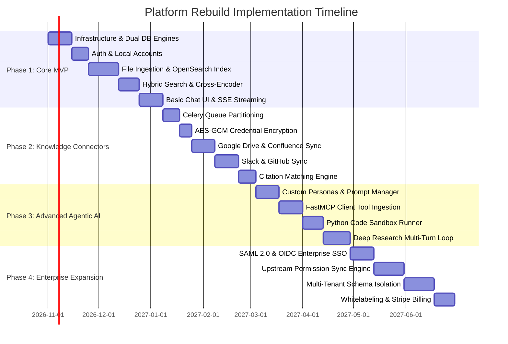

# Implementation Priorities & Phased Delivery Strategy

This document outlines a phased execution strategy for rebuilding an Onyx-equivalent platform, separating the Minimum Viable Product (MVP) from subsequent enterprise expansion tiers.

---

## 1. Phased Delivery Roadmap

---

## 2. Phase Breakdown

### Phase 1: Core RAG & Chat MVP (Months 1–2)
**Goal**: Deliver a working internal AI knowledge base where users can upload files, ask questions, and receive streamed answers with citations.

- **Included Features**:
  1. Base FastAPI + Next.js microservices.
  2. Local username/password authentication.
  3. Direct file uploads (PDF, DOCX, TXT) with semantic chunking.
  4. OpenSearch vector + BM25 indexing with cross-encoder reranking.
  5. Multi-provider LLM gateway (OpenAI + Anthropic).
  6. Streaming chat interface with inline citations.
- **Why First**: Validates the core user proposition with minimal external dependency risk.

---

### Phase 2: Live Workplace Connectors (Months 2–3)
**Goal**: Automate real-time knowledge ingestion from company tools.

- **Included Features**:
  1. Celery task queues (`indexing`, `docfetching`, `pruning`).
  2. AES-GCM 256 credential store.
  3. Foundational connectors: Google Drive, Slack, Confluence, GitHub.
  4. Celery Beat periodic synchronization and stale lock cleanup.
- **Why Second**: Moves the product from a static file reader to a live, self-updating enterprise brain.

---

### Phase 3: Autonomous Agents & Tool Calling (Months 3–4)
**Goal**: Transform search into an active workbench with specialized assistants and external actions.

- **Included Features**:
  1. Persona creation and document set scoping.
  2. FastMCP client for dynamic tool discovery.
  3. Python code interpreter in isolated container.
  4. Autonomous Deep Research loop.
  5. Slackbot and Discord bot integrations.
- **Why Third**: Multiplies user productivity and expands adoption into chat channels.

---

### Phase 4: Enterprise Hardening & Commercialization (Months 4–5)
**Goal**: Ready the platform for deployment in large corporations and multi-tenant SaaS.

- **Included Features**:
  1. SAML 2.0 (Okta) and OIDC SSO.
  2. Upstream ACL permission synchronization.
  3. Multi-tenant schema separation (`tenant_<uuid>`).
  4. Whitelabeling, usage quotas, and Stripe billing.
  5. Kubernetes Helm production deployment.

---

## 3. Team Composition & Engineering Allocation

To rebuild Onyx within 5 months, the recommended engineering squad consists of:

1. **Backend / Data Engineers (2x)**:
   - Own Celery queues, connector API integrations, OpenSearch indices, and PostgreSQL schemas.
2. **AI / Retrieval Engineers (1x)**:
   - Own LiteLLM integration, chunking heuristics, embedding models, cross-encoders, and citation verification.
3. **Frontend Engineers (1x)**:
   - Own Next.js 16 App Router, UI components, SSE stream decoding, and admin dashboards.
4. **DevOps / Security Engineer (1x)**:
   - Own Docker Compose, Helm charts, Redis locks, encryption keys, and Sentry/Prometheus monitoring.

